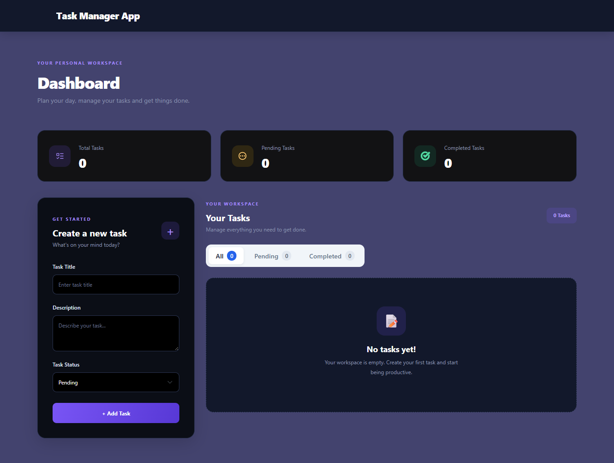

# Task Management Application

A full-stack task management application built using the **MERN Stack (MongoDB, Express.js, React.js, and Node.js)**. TaskFlow helps users manage their daily activities by creating, updating, viewing, and deleting tasks through a simple and user-friendly interface.

---

## 📌 Project Overview

TaskFlow is a task management web application that allows registered users to manage their personal tasks efficiently. Users can register, log in, create tasks, update task details, track task status, and delete tasks.

The application uses a REST API backend with MongoDB for data storage and React for the frontend user interface.

---

## ✨ Features

### User Authentication
- User registration
- User login
- User logout
- Authentication middleware for protected routes
- User-specific task management

### Task Management
- Create new tasks
- View all personal tasks
- Edit existing tasks
- Delete tasks
- Update task status
- Pending and completed task tracking

### Dashboard
- View total tasks
- View pending tasks
- View completed tasks
- Manage tasks from a centralized dashboard

### User Interface
- Responsive design
- Modern dark-themed interface
- Form validation
- Password visibility toggle
- Toast notifications
- Loading states
- Confirmation before deleting tasks

---

## 🛠️ Technologies Used

### Frontend
- React.js
- React Router DOM
- Redux Toolkit
- React Redux
- Axios
- React Bootstrap
- Bootstrap
- Formik
- Yup
- React Toastify
- CSS3

### Backend
- Node.js
- Express.js
- MongoDB
- Mongoose
- JWT Authentication
- bcrypt / bcryptjs for password hashing
- dotenv
- CORS

---

## 📂 Project Structure

### Frontend

```text
frontend/
├── public/
├── src/
│   ├── axios/
│   │   └── instance.js
│   ├── components/
│   │   ├── Signup.jsx
│   │   ├── Login.jsx
│   │   ├── Home.jsx
│   │   ├── AddTask.jsx
│   │   ├── EditTask.jsx
│   │   ├── TaskList.jsx
│   │   ├── signup.css
│   │   ├── login.css
│   │   └── home.css
│   ├── redux/
│   │   ├── userSlice.js
│   │   └── store.js
│   ├── App.jsx
│   └── main.jsx
└── package.json
```

### Backend

```text
backend/
├── config/
│   └── db.js
├── controllers/
│   ├── userController.js
│   └── taskController.js
├── middleware/
│   └── authMiddleware.js
├── models/
│   ├── User.js
│   └── Task.js
├── routes/
│   ├── userRoutes.js
│   └── taskRoutes.js
├── .env
├── server.js
└── package.json
```

---

## 🚀 Installation and Setup

### 1. Clone the Repository

```bash
git clone <https://github.com/kur1an/task-manager-app.git>
```

Navigate to the project folder:

```bash
cd 
```

### 2. Backend Setup

Navigate to the backend folder:

```bash
cd backend
```

Install dependencies:

```bash
npm install
```

Create a `.env` file in the backend root directory:

```env
PORT=5000
MONGODB_URI=mongodb://127.0.0.1:27017/taskflow
JWT_SECRET=your_secret_key
```

Configure your MongoDB connection string and JWT secret.

Start the backend server:

```bash
npm start
```

If you use Nodemon:

```bash
npm run dev
```

### 3. Frontend Setup

Open a new terminal and navigate to the frontend directory:

```bash
cd frontend
```

Install dependencies:

```bash
npm install
```

Start the React development server:

```bash
npm run dev
```

The application will be available at the URL shown in your terminal, usually:

```text
http://localhost:5173
```

---

## 🔐 Authentication

TaskFlow uses authentication to protect user-specific resources.

- Users can register and log in.
- Passwords should be securely hashed before storing in the database.
- Protected routes require valid authentication.
- Authentication middleware verifies the user and provides the authenticated user's ID to controllers.
- Users can access and manage only their own tasks.

---

## 📋 Task Status

Tasks can have the following statuses:

| Status | Description |
|---|---|
| Pending | Task has not been completed |
| Completed | Task has been completed |

---

## 🔗 API Endpoints

### User Routes

| Method | Endpoint | Description |
|---|---|---|
| POST | `/users/signup` | Register a new user |
| POST | `/users/login` | Login an existing user |

### Task Routes

| Method | Endpoint | Description | Authentication |
|---|---|---|---|
| POST | `/tasks/create` | Create a new task | Required |
| GET | `/tasks/all` | Get all user tasks | Required |
| PUT | `/tasks/edit/:taskId` | Update a task | Required |
| DELETE | `/tasks/delete/:taskId` | Delete a task | Required |

> Note: API endpoints assume the backend routes are mounted under `/users` and `/tasks`. Adjust the paths if your server uses a different API prefix.

---

## 📦 Task Data Structure

Example task document:

```json
{
  "_id": "task_id",
  "taskTitle": "Complete Project",
  "taskDesc": "Finish the MERN stack task management application",
  "taskStatus": "pending",
  "user": "user_id"
}
```

### Task Fields

| Field | Type | Description |
|---|---|---|
| `taskTitle` | String | Title of the task |
| `taskDesc` | String | Task description |
| `taskStatus` | String | Pending or completed |
| `user` | ObjectId | Reference to the task owner |

---

## 🧪 Form Validation

Formik and Yup are used for frontend form validation.

### Signup Validation
- Full name is required.
- Email must be valid.
- Password must meet the configured validation rules.

### Login Validation
- Email is required and must be valid.
- Password is required.

### Task Validation
- Task title is required.
- Task description is required.
- Task status is required.

---

## 🔄 Application Workflow

1. User registers an account.
2. User logs in using email and password.
3. Authentication is verified by the backend.
4. User accesses the task dashboard.
5. User creates, views, edits, or deletes tasks.
6. Task data is stored in MongoDB.
7. Dashboard updates to reflect task changes.

---

## 📸 Screenshots

Add screenshots of your application here.

```text
screenshots/
├── signup.png
├── login.png
├── dashboard.png
├── add-task.png
└── edit-task.png
```

Example:

```markdown

```

---

## 🔮 Future Enhancements

- Search tasks
- Filter tasks by status
- Sort tasks by creation date
- Task deadlines and reminders
- Pagination
- User profile management
- Forgot password functionality
- Task priority levels
- Dark/light theme toggle

---

## 👨‍💻 Author

**Project:** Task Management Application

**Technology:** MERN Stack

---

## 📄 License

This project was developed for educational and portfolio purposes.
